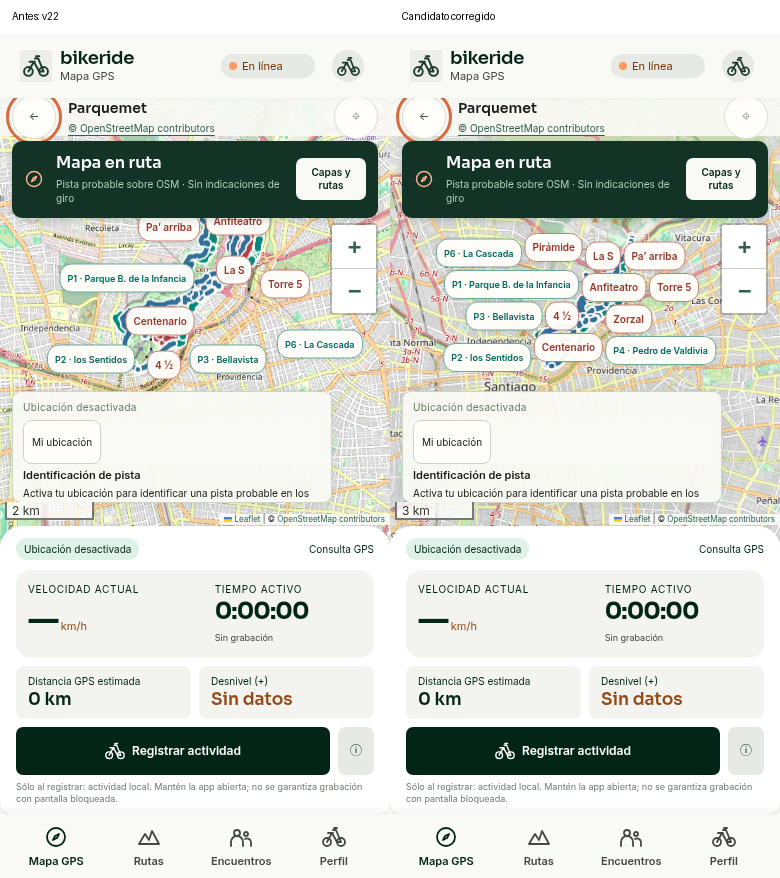

# Rótulos móviles y siguiente paso geográfico

27-10-2026. Continuación de `0d1f442`, misma rama/worktree. **Sin nueva publicación ni cambios a main.** La equivalencia geográfica de los senderos sigue pendiente; este cambio cierra el fallo de rótulos y concreta el dato faltante.

## Rótulos: fallo reproducido y corregido

La vista390×844 colocaba Anfiteatro y otros nombres bajo el banner/HUD, superponía rótulos y dejaba cajas invisibles de marcadores interceptando toques. La colocación antigua no medía los controles nuevos y su fallback permitía colisiones.

El nuevo cálculo reserva banner, HUD, GPS, ficha, capas, zoom, atribución y avisos realmente visibles. Prioriza el sendero seleccionado y los ocho ciclistas; busca espacio en la pantalla y en los bordes exactos de los obstáculos. Sólo traslada los textos y sus líneas de llamada: **no cambia las coordenadas de las rutas ni los anclajes**. Si no hay espacio, oculta el rótulo; la línea y la selección en la lista siguen disponibles. Las cajas vacías no interceptan toques. Cambios de tamaño/visibilidad actualizan los rótulos, sin mover la cámara por esa actualización.

La revisión independiente detectó un hueco estrecho que una rejilla de10px omitía: Anfiteatro seleccionado cabía entre banner y GPS, pero se ocultaba. Se añadió su reproducción unitaria —falló antes de corregir— y una comprobación táctil real; la búsqueda incluye ahora los bordes exactos de los controles. No se redujeron las aserciones de cobertura. Los tests anteriores abren el menú vigente con los helpers existentes, en vez de pulsar controles ocultos.

La vista390px muestra los ocho nombres ciclistas sin colisiones y permite tocar el texto Anfiteatro para abrir su ficha. En pantallas más pequeñas o al abrir paneles, la cantidad de rótulos simultáneos depende del espacio; el catálogo y la geometría permanecen completos.

[Vista completa corregida](after-390.png) · [Sendero seleccionado](selected-390.png) · [Teléfono pequeño](after-320.png) · [Revisión independiente](final-review.md) · [Medidas y pruebas](verification.json).

## Lo histórico que ya revisamos

- `visor-vectorial.html`, introducido en44cca10, conserva A=`[303,971]` → lat/lon`[-33.32184,-70.51284]` y B=`[774,345]` → `[-33.30132,-70.49373]`. Sus píxeles son del SVG ilustrativo, sin vínculo demostrado con los píxeles oficiales; no se reutilizan las rutas incorrectas ni se transfieren esas posiciones al JPG como controles.
- A coincide por redondeo con el marcador genérico OSM9258698134, aproximadamente171m del portón9258698133. B coincide con el mirador4705647672; el extremo de Subida es otro nodo. Se conservan las coordenadas como candidatos y **no hace falta volver a escribirlas**.
- Las fotografías originales, el PDF/JPG oficial, registros y commits accesibles ya se revisaron. Las calibraciones de la app antigua viven en IndexedDB `mapas-gps-v1/maps` del navegador del propietario. No se encontró una exportación personal en los adjuntos/paquetes disponibles; no se confunden las pruebas sintéticas de conservación con una calibración real del usuario.
- No se encontró un enlace Google Maps aportado por Rodrigo en esos materiales accesibles. El embed encontrado en Wikiexplora es de terceros. **No tenemos aquí el historial completo del chat ni el IndexedDB del dispositivo**, por lo que no afirmamos que ese enlace/calibración nunca se haya enviado. Si existe, el siguiente paso es recuperar ese aporte, no rehacerlo ni pedir nuevas coordenadas por formato.

## El Durazno: cinco hitos concretos

Coordenadas de imagen del JPG oficial2570×3077, origen superior izquierdo. Los identificadores enlazan a referencias públicas OSM; todavía no son controles aceptados ni acreditan precisión en terreno.

| Hito reconocible | Marca o región del plano | Evidencia mínima pendiente |
| --- | --- | --- |
| Llegadas inferiores Lomo Vetado / Calibre12, junto a Los Saltos | Azul`[1214.56,1605.57]`, negro`[1243.32,1616.35]` y blanco cercano`[1238.98,1645.38]` | Identificar cuál representa el mapa/cruce [4705608441](https://www.openstreetmap.org/node/4705608441), distinguiéndolo de Plaza Saltos9258698201. Si las dos pistas llegan al mismo lugar, una referencia existente debe explicar la separación editorial de los círculos; si son lugares distintos, identificar el segundo. No asignar automáticamente una coordenada a ambos píxeles. |
| Estatua Virgen | Icono`[1860.21,595.51]`; círculo final La Virgen`[1831.30,604.39]` | Relacionar la estatua física [9258698197](https://www.openstreetmap.org/node/9258698197) con una marca inequívoca del plano; no usar su icono o el círculo indistintamente. Una foto/anotación identificada o referencia geográfica ya existente puede aclarar identidad. |
| Mirador Buitrera y final Subida | Mirador`[1869.52,634.28]`; extremo rojo`[1843.21,662.29]` | Recuperar qué hito señalaba B: [mirador4705647672](https://www.openstreetmap.org/node/4705647672) o [extremo397645997](https://www.openstreetmap.org/node/397645997). Reutilizar su coordenada histórica cuando se acredite el objeto; falta su correspondencia con el plano oficial. |
| Acceso/base | Región principal`[600,2170,235,326]`; ampliación insertada en otro marco | Identificar qué objeto señalaba A: marcador general, base/tienda o [portón9258698133](https://www.openstreetmap.org/node/9258698133). Si era el portón, hace falta una referencia que marque su umbral y su correspondencia en el mapa principal; el «ACCESO» del inserto no es ese píxel. |
| Encuentro Rock N’Roll / XL, sector este | Círculos El Duro`[2283.68,1988.12]` y Rock`[2280.09,2005.03]` | Relacionar el cruce físico [397646284](https://www.openstreetmap.org/node/397646284) con uno de los círculos mediante pin/anotación/cartografía identificada; no trasladar ambos al mismo nodo por proximidad. |

[Recortes numerados](durazno/five-candidate-source-regions.png) · [Tabla completa con coordenadas y fuentes](durazno/PLAN-DE-CONTROLES.txt) · [JSON editable](durazno/action-plan.json).

**Primer dato útil:** una anotación o referencia existente que resuelva el primer grupo, y el significado físico de B. No se necesita redibujar los senderos, introducir de nuevo A/B ni ir al parque. Resolver identidad permite avanzar la correspondencia; por sí solo no valida toda la transformación ni la navegación.

## Parquemet: cinco referencias priorizadas

Marco del JPG6690×2835. Sus edificios/flechas son ilustraciones; sus centros no son puntos topográficos.

| Referencia | Marca/región del plano | Evidencia mínima pendiente |
| --- | --- | --- |
| Centenario, símbolo compartido con4½ | Objeto1269, región`[1647.65,1206.28,8.97,8.97]` | Esas rutas comparten **dos** nodos OSM: [4728164940](https://www.openstreetmap.org/node/4728164940) y [5009936028](https://www.openstreetmap.org/node/5009936028), separados unos270m. Falta una traza/croquis oficial o referencia con extremos identificados que indique cuál representa el círculo; el nombre no decide. |
| Zorzal, símbolo compartido con Anfiteatro | Objeto1279, región`[3502.95,1250.22,8.86,8.86]` | Identificar su extremo hacia Anfiteatro [6484453802](https://www.openstreetmap.org/node/6484453802) y el opuesto8613999020; aclarar si el círculo es unión física o agrupación editorial. La S y Pa’ arriba contactan Anfiteatro en otros nodos. No confundir este símbolo con1269. |
| Acceso Carlos Reed | Flecha editorial`[1748,1424,33,35]` | Falta una referencia pública/oficial del portón concreto y su correspondencia con el dibujo. El nodo4728182188 es contexto de senderos, **no** una puerta acreditada. Conservar la flecha como referencia de área si no representa un punto preciso. |
| Estación Cumbre | Edificio ilustrado`[1446,964,62,62]` | Falta huella/entrada física pública u oficial identificada. Sirve primero para identidad/orientación; no usar centro de icono como ancla. |
| Estación Tupahue | Edificio ilustrado`[2176,1108,68,68]` | Falta huella/entrada física diferenciada de piscina/mural;2953717033 es un cruce vial de contexto, no coordenada de estación. Tampoco usar centro de icono como ancla. |

[Tabla completa](parquemet/plan-es.txt) · [Coordenadas candidatas y fuentes](parquemet/control-action-plan.json) · [Centenario](parquemet/centenario-shared1269-source.png) · [Zorzal](parquemet/zorzal-shared1279-source.png).

**Primer dato útil:** una sola referencia legítima —por ejemplo GPX/KML/GeoJSON o croquis del operador— que identifique los extremos de Centenario y Zorzal, con nombre/edición/procedencia. Alternativamente, un aporte previo con esos puntos expresamente rotulados puede resolver la identidad. No hace falta que el usuario visite el parque. Aunque resuelva esos extremos, no garantiza que el panorama completo admita una transformación única.

## Búsqueda oficial realizada antes de pedir datos

La página oficial actual de Outlife mantiene el mismo PDF/JPG2022 sin archivos geográficos identificados. La noticia oficial del evento2025 describe Lomo→PlazaSaltos→Cebolla y otras páginas documentan instalaciones/cambios de pistas; no publican coordenadas de los extremos ni resuelven los círculos. El portal `mapas.parquemet.cl` respondió200 el27-10-2026 con el mismo contenido que la revisión anterior: PDFs, portal de parques y perfil SUDA, sin enlace identificado a GIS/GPX/KML/GeoJSON. Las actividades SUDA de running ya revisadas no se reinterpretaron como red ciclista.

Se conservan URL/fecha/estado/hash en los JSON de cada parque. La búsqueda fue acotada, no una afirmación de inexistencia universal. No se contactó a terceros, contrató servicio, usó geometría protegida ni publicó ubicación personal.

**Estado geográfico:** cero controles nuevos aceptados; matriz anterior intacta, `acceptedTransform:null`. Una identidad confirmada y un par píxel/coordenada con procedencia habilitan evaluar un control, pero la exactitud del modelo exige comprobaciones independientes fuera del ajuste. No imponemos una cuota de puntos como garantía.

## Verificación de esta corrección

Resultados definitivos en [verification.json](verification.json), logs y revisión adjunta. La suite completa del proyecto y la suite anterior de cobertura se vuelven a ejecutar después de la corrección de revisión; además se prueban fuente/paquete, GPS, filtros, navegación,47 fichas, persistencia y consentimiento. No son pruebas de GPS en terreno ni en un teléfono físico. No se publica esta etapa.
