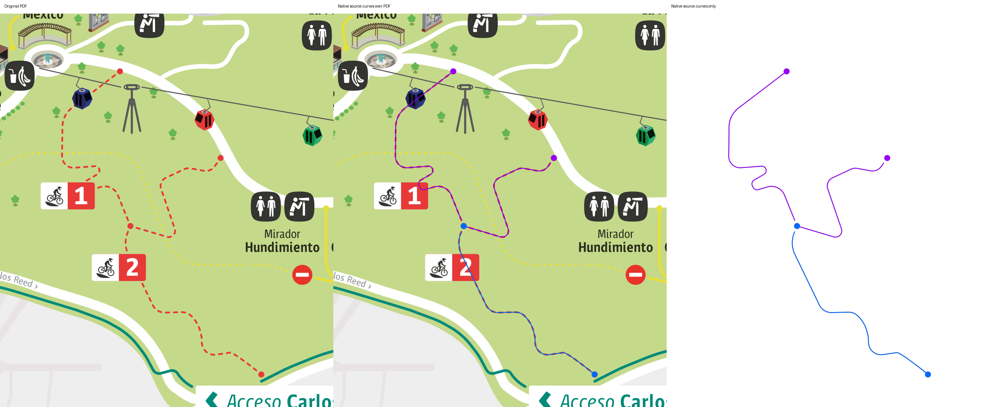
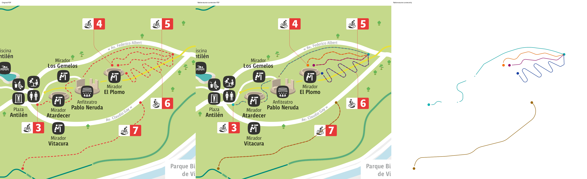
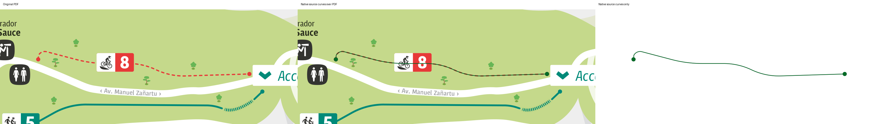

# Cobertura ciclista y miniaturas del plano oficial

2026-10-20. Rama `fix/parquemet-cycling-coverage`, worktree aislado `parquemet-coverage`, base `d57cd34`. Se conserva la aplicación anterior y sus almacenes; no se modifica `main` ni GitHub Pages.

## Resultado y procedencia

Había ocho fichas y sólo seis nombres atribuidos al snapshot. Zorzal y Pa’ arriba existían como contexto gris por variantes explícitas de nombre. Ahora se conservan 62 vías originales con 1.980 nodos: 59 atribuidas a ocho senderos y nueve avenidas, tres de contexto. No se corrigieron coordenadas ni se adaptaron a la forma del esquema. Las vías restringidas se dibujan discontinuas y permanecen excluidas del ajuste GPS. [IDs, versiones, discrepancias, condiciones y referencias](parquemet-coverage-sources.md).

El encuadre inicial prioriza senderos ciclistas, sus trazos tienen mayor peso y ocho rótulos evitan controles y solapamientos en la vista móvil comprobada. Las avenidas siguen disponibles con menor contraste. Los enlaces del panel inferior abren la comparación con el sendero seleccionado en el plano.

`data/parquemet/visual-cycling-trails.json` contiene ocho senderos, 43 objetos nativos del PDF (30 trazos y 13 marcas de extremo), 120 curvas Bézier y 78 segmentos lineales. Extracción sin simplificación, interpolación ni rectificación: tolerancia de simplificación **0 píxeles**; la precisión decimal de salida se documenta en [la evidencia de extracción](parquemet-pdf-traces.md). Se preservan los dos huecos de Anfiteatro. El visor comparte el mismo SVG padre para el raster6690×2835 y las curvas; zoom y desplazamiento aplican la misma matriz. Permite plano, superposición con opacidad y sólo vectores, selección y encuadre individual o conjunto.

La superposición interactiva enfatiza las líneas con grosor de pantalla3px y trazo continuo; las miniaturas usan1,7px. Es un cambio de estilo: todos los comandos `d`, las curvas, los extremos y las separaciones permanecen idénticos al PDF. Los datos guardan también el estilo discontinuo original. Los paneles comparativos conservan los colores de contraste para revisar cada ruta.

Cada ficha ciclista de Parquemet muestra exclusivamente sus trazos oficiales, sin raster, rótulos ni otras rutas; al desplegarla aparece una vista188px ampliable, y al tocarla abre sólo ese recorrido. Las veinte fichas identificadas de El Durazno reutilizan sus contornos nativos existentes; no se repasa ni sustituye la geometría. Buitrera indica falta de identificación específica: no se atribuye a una subida parecida del cartel. Las fichas cerradas y el mapa siguen midiendo176px.

## Verificación ejecutada

- `npm test`: **102/102**. Incluye datos, identidades/variantes, huellas completas de coordenadas y versiones OSM, límites y correspondencia PDF, exclusiones GPS, transformaciones, miniaturas y bytes exactos embebidos en ambos bundles.
- `python3 scripts/extract-parquemet-cycling.py --check`: reproducción exacta de la extracción.
- `node tests/parquemet-coverage-browser.mjs`: ocho líneas geográficas y rótulos, sin solapamiento inicial en390×844, selección/restricciones, ocho grupos nativos, matrices raster/vector idénticas antes/después de zoom, vectores y superposición, ocho miniaturas con comandos originales y ampliación aislada. Ejecutado en fuente y standalone (`PARK_ENTRY=/dist/parquemet.html`).
- `node tests/trail-preview-browser.mjs`: veinte miniaturas exactas, Buitrera sin atribución falsa, tarjetas176px y títulos separados de las imágenes,390/320px y ampliación seleccionada. Ejecutado en fuente y standalone (`PREVIEW_ENTRY=/dist/index.html`).
- `node tests/parquemet-visual-integrity.mjs`: alterar los bytes de las curvas falla explícitamente en fuente y bundle; OSM y el PDF original siguen disponibles.
- Regresiones: `parquemet-browser.mjs`, cuatro grupos de `parquemet-hardening.mjs` (pinch/arrastre/orientación, integridad OSM, permiso/cancelación GPS y enlaces), nueve comprobaciones de `geographic-acceptance.mjs`, tres de `geographic-regressions.mjs`, y `gps-browser.mjs` (demo pública, continuidad, incertidumbre, señal antigua, permiso denegado, salida y almacenamiento). La prueba con service worker conserva Blob, calibración, senderos y centro de mapas guardados.
- Revisión independiente: 2.042 objetos OSM comparados con la respuesta Overpass original sin diferencias salvo metadata de contribuyentes; comprobación de los tres paneles PDF/overlay/vectores y pruebas específicas16/16. Sin hallazgos críticos ni importantes.
- Inspección visual directa de las tres comparaciones siguientes y de las capturas móviles de mapa, superposición y ficha.

[Mapa móvil con ocho rótulos](parquemet-coverage/world-all8-mobile.png), [superposición](parquemet-coverage/official-overlay-mobile.png), [ficha Centenario](parquemet-coverage/centenario-preview-mobile.png), [ficha La Virgen](parquemet-coverage/el-durazno-preview-mobile.png).

## Límites y continuación

El PDF es esquemático y no se ha proyectado sobre el mapa mundial. Su `georeferencing.transform` y la correspondencia geográfica del catálogo siguen en `null`; una identidad nominal OSM no demuestra concordancia de todas las curvas ni acceso vigente. No se calcularon distancias de terreno a partir del dibujo. Se conservan longitudes publicadas PDF y medidas OSM por separado. No se validaron en terreno conexiones, sentidos, accesos, desniveles, navegación ni loops. Paseo Metropolitano aparece en el documento pero aún no tiene geometría geográfica atribuida: el track de running hallado no acredita correspondencia y no se importó.

Abrir en desarrollo: `python3 -m http.server 4178` en este worktree, luego `http://localhost:4178/parquemet.html#parque=parquemet`. Es una URL local de la máquina del servidor, no un enlace público. Para construir: `python3 scripts/build-geographic-standalone.py`; la foto privada sólo se incorpora pasando `--reference-photo /ruta/privada/81184.jpg` y nunca debe subirse a Git. Los bundles quedan en `dist/index.html` y `dist/parquemet.html`. Publicación privada y verificación HTTPS se registran por separado en `parquemet-coverage-release.md` al concluir la entrega.
